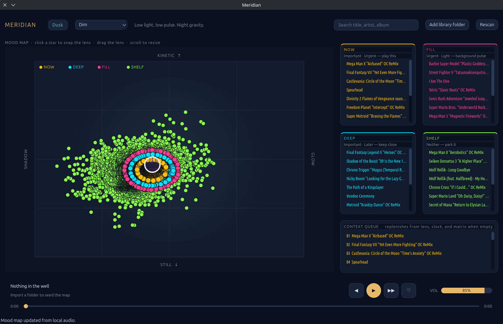
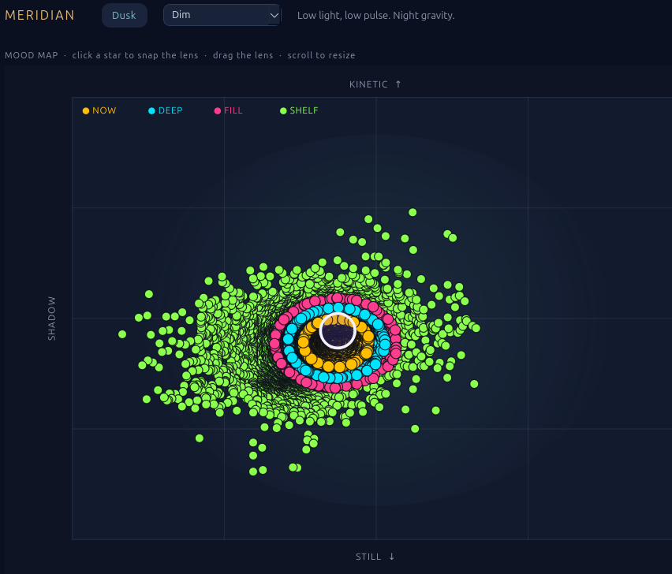
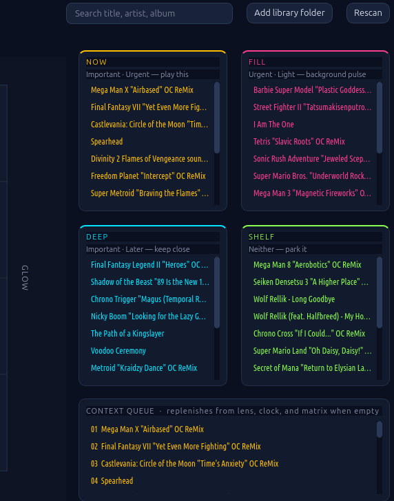

# Meridian-lab

This is the testing repo for Meridian. New ideas get tried here. They can break, change, or get thrown away.

Lab `main` was updated 2026-11-11. The lab release AppImage is that same day’s image: it ships an LGPL ffmpeg for mood analysis, and its aubio build does not need host `libx264`. The sky zooms in stops without moving stars. The time bar marks the stretches that listen used. Download it from the [releases page](https://github.com/dark1ltg/Meridian-lab/releases).

Meridian turns your music library into a night sky. Each song is a star. Left to right is mood, from shadow to glow. Bottom to top is energy, from still to moving.

The time bar under the song has a quiet tick for each stretch the short listen actually used. Click one and the song jumps there, so you can hear the opening, the middle, or the end that placed the star. The star stays put. Songs heard before these marks were saved use the plan their length would have used until the next listen stores the real starts.

Drag the lens to the part of the sky you feel like. The four lists beside the map fill with the songs under that lens:

- **NOW** — play these
- **DEEP** — stay with this mood
- **FILL** — songs that fit in between
- **SHELF** — keep these nearby, not yet

When that neighborhood feels right, press **Renew**. That commits the queue.

A finish or a skip slides that unpinned star a short way, and leaves a faint mark where it was. Search draws a brief line from the lens to the song you picked, then the line fades. A weak guess, including a confidence of zero, stays a dim star. A song the listen cannot hear, and that has no genre or mood words, still sits in the middle as that dim star. When the start, middle, and end of a song agree, that star looks a little more sure. A shaky song on a tight album looks less sure and stays where the listen put it. Songs that share a dot stay stacked.

Zoom has four stops, and a star never moves to unstack. A pin stays. Songs on one exact spot stay one dot.

Under 1.6× the sky is the wide picture. Several songs on a spot are one dot and a count. A song alone is one dot. Coarse neighborhood lines are visible. No names. Nothing can be dragged.

From 1.6× to 2.4× the sharper patch stays. The coarse lines fade and are gone at 2.4×. Finer neighborhood lines are not drawn. A pile is still one dot and a count. The dot under the pointer can show a short name. Clicking a pile zooms closer. Stars cannot be grabbed here, including while a pinch is in progress. A drag pins a star only after the close view has settled.

At 2.4× the lines are gone. The count fades and the songs in that spot become real stars, still on the places they already had. Names come in dim and are readable by 2.6×. Each close star can show one short line: how sure the spot is, or “no listen” when that is why it sits in the middle. A pin shows that it is pinned. The song that is playing shows that it is playing. Artist and album stay in the lists and the bar. There is no card on the star.

The zoom stops at 5×. From 2.6× to 5× those stars stay on their spots, so a loose cluster opens up. The 220 live stars are spent on the cluster under the lens. The wide picture is cut out of that cluster. The edges of the view stay the picture. You can drag a settled close star. A pin and the playing song stay bright. Stars packed together draw dimmer. The star under the pointer stays bright on the wide sky too. Pinning a song, or the next song starting, updates that one star.

  
  &nbsp;
  

