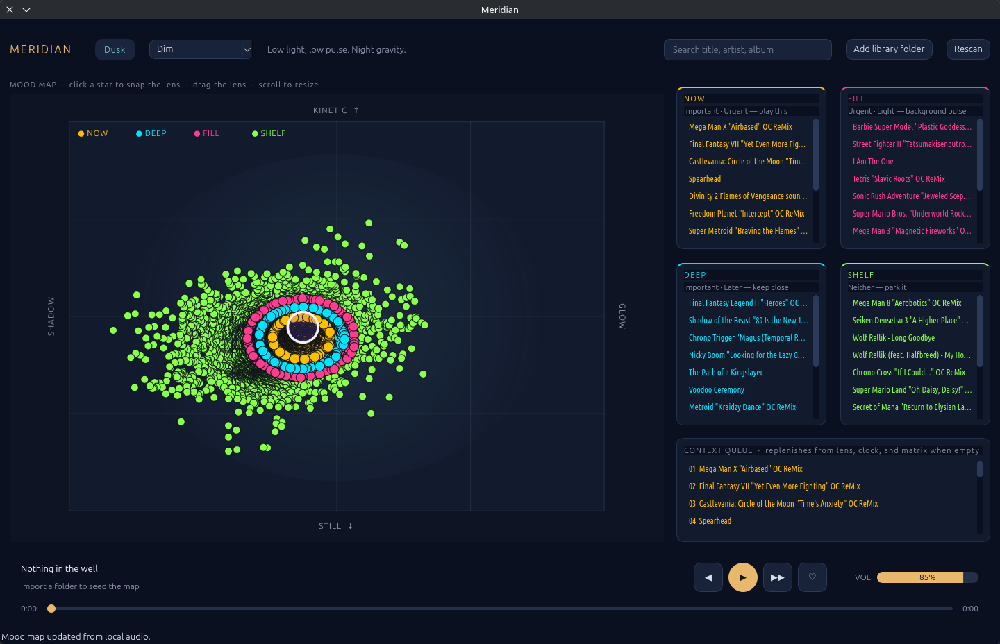
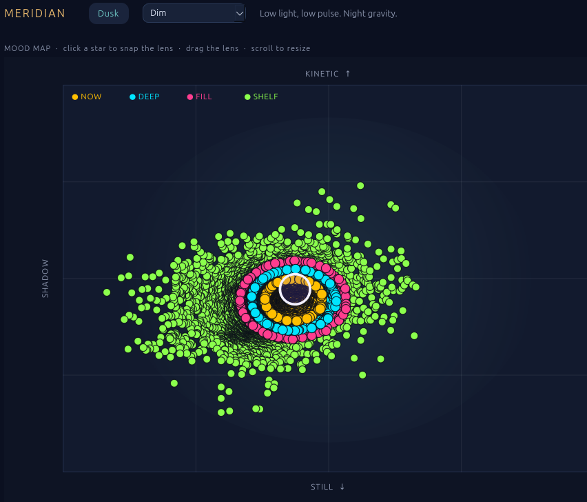
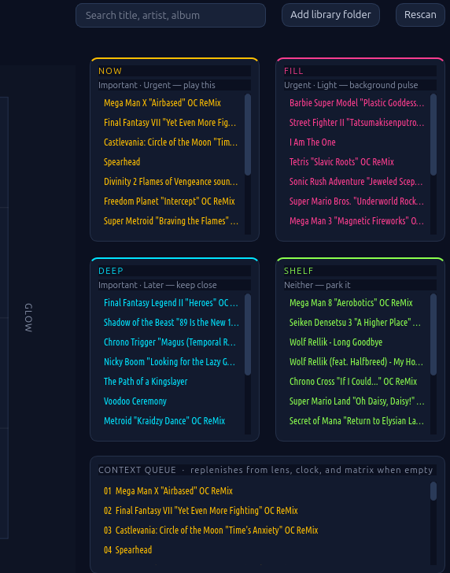

# Meridian-lab

This is the testing repo for Meridian. New ideas get tried here. They can break, change, or get thrown away.

Meridian turns your music library into a night sky. Each song is a star. Left to right is mood, from shadow to glow. Bottom to top is energy, from still to moving.

Drag the lens to the part of the sky you feel like. The four lists beside the map fill with the songs under that lens:

- **NOW** — play these
- **DEEP** — stay with this mood
- **FILL** — songs that fit in between
- **SHELF** — keep these nearby, not yet

When that neighborhood feels right, press **Renew**. That commits the queue.

A finish or a skip slides that unpinned star a short way, and leaves a faint mark where it was. Search draws a brief line from the lens to the song you picked, then the line fades. A weak guess, including a confidence of zero, stays a dim star.

Zoom in a little and, once the pinch stops, the patch you are looking at is drawn sharper, from the songs in that patch. A bit closer, that picture is replaced by a tighter one. The wide sky stays one picture. Neighborhood lines get finer there. In close, the stars you can click take over. Pinning a song, or the next song starting, updates that one star.

  
  &nbsp;
  

